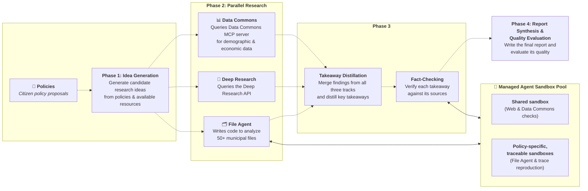

# Panoramic AI Insights: Multi-Agent Policy Research & Verification


## 1. Goals

We aim to use AI agents to help municipal policymakers make informed decisions. Prompting an LLM with a policy proposal is easy, but generating insights that are consistently useful for local government is much harder. Relevant context is scattered across government departments and public sources in many formats—from municipal budgets and 311 service logs to city code chapters, council transcripts, and census data. Moreover, because these insights inform decisions that directly impact residents, our tolerance for hallucination is zero. Even accurate numbers do not automatically become useful policy insights: the system must understand local institutional realities, such as how municipal budgets work, rather than naively linking a pothole complaint to an unrelated budget line with a similar name.

Working with Chattanooga city staff, we structured each report around two sections grounded in resident quotes and source citations:

* **Problem Definition**: Sizes the local issue (`problem_sizing`) and explains its impact on residents (`resident_impact`), opening with a concise **TL;DR**.
* **Recommendation**: Outlines an actionable implementation path (`implementation_path`), peer-city precedents (`reference_point`), and cost estimates tied to the city budget (`cost_estimate`), also opening with a concise **TL;DR**.

---

## 2. Implementation

Rather than relying on a single LLM call, we divide the workflow into four phases. A single call cannot simultaneously run Python scripts in a container, query statistical APIs, and conduct deep web research; separating broad evidence gathering from downstream distillation, verification, and report synthesis also prevents the model from losing focus across tens of thousands of tokens of raw data.

<details>
<summary><strong>Mermaid Architecture Source</strong></summary>



</details>

In **Phase 1 (Idea Generation)**, an agent reviews the policy proposal and available tools to propose initial research directions. **Phase 2 (Parallel Research)** then runs three specialized agents in parallel, divided by the data access and execution environment they need:

* **File Agent (Waverunner Sandbox)**: Analyzes over 50 trusted government and civic files (such as 311 requests, traffic logs, budgets, city code, transcripts, and domain briefs) plus Chattanooga's GIS API. Starting from initial research ideas, the agent explores freely—reading files, writing Python scripts to process data, diving deeper into strong evidence, or pivoting to new angles—while recording a calculation trace for every figure. Two optimizations make the File Agent fast and scalable:
  1. **Corpus Indexing (`config.json`)**: An indexing agent pre-generates a summary and column guide for each file (for instance, explaining non-obvious columns in the 311 spreadsheet) so the File Agent understands every file at a glance.
  2. **Decoupled Sandbox Pool**: Because running many File Agents in parallel shifts the bottleneck from LLM quota to sandbox capacity, we decoupled tasks into a pool of sandbox workers mounted to a shared read-only `/data/` filesystem with isolated per-task working directories. Both File Agent tasks and downstream fact-checking tasks pull from a priority queue, allowing us to prioritize initial research during fast iteration.
* **Data Commons Agent**: A Gemini tool-use agent that queries the Data Commons API for demographic, economic, and commute statistics.
* **Deep Research Agent**: A direct call to Gemini's Deep Research API to gather peer-city case studies and policy evaluations from public web sources.

**Phase 3 (Takeaway Distillation & Fact-Checking)** distills the raw Phase 2 outputs into atomic takeaways across our target categories—each paired with its source link and calculation trace—and runs sandbox fact-checking to filter out any takeaway that cannot be verified. **Phase 4 (Report Synthesis & Quality Evaluation)** then weaves only the verified takeaways into a coherent report in a single structured pass, generating each section's supporting points before writing its opening TL;DR so that every headline figure is grounded in the text below.

---

## 3. Quality and Evals

To enforce zero tolerance for hallucination before the report is written, every takeaway in Phase 3 must link to its primary source and pass an adversarial sandbox fact-checking step. For File Agent takeaways, a judge agent enters the task's original sandbox workspace and runs verification scripts using the recorded trace to confirm that the numbers can be reproduced from the raw files. For Data Commons and Deep Research takeaways, a sandbox makes live HTTP calls to fetch the cited sources and confirm that the claimed statistics appear in the text. Any takeaway that fails verification is discarded before Phase 4.

When composing the final report in Phase 4, our prompts enforce strict editorial guidelines to ensure readability and institutional fit. Reports are written at an 8th-grade reading level in an administratively neutral tone—clear enough to be read aloud at a town hall without jargon or unverified critiques of city departments. The guidelines also forbid speculative financial projections, require a direct connection between the problem and the recommended solution, and respect jurisdictional boundaries between city departments and independent authorities.

Finally, to evaluate the overall quality and usefulness of the Phase 4 reports, we built a golden set of evaluation rubrics aligned with human experts, drawing on feedback from Chattanooga city employees and our team. Starting from a heuristic set of binary (`Yes`/`No`) questions, human raters independently scored reports in our evaluation UI, and we measured agreement using Inter-Rater Reliability (Fleiss' $\kappa$). We kept the rubrics where raters aligned; where raters diverged, they discussed their reasoning in comment threads to identify the source of disagreement and replace ambiguous items. This converged on 18 well-aligned rubrics that now power an auto-rater to score and filter reports at scale.

---

## 4. Pipeline Structure & Usage

### Key Files

| File | Description |
| :--- | :--- |
| `config.json` | Registry of local municipal datasets (`/data/...`), canonical `source_url` mappings, editorial metadata, and GIS API tools. |
| `insights_prompts.py` | Prompt templates and Pydantic output schemas across all phases. |
| `phase_1_generate_research_ideas_prompts.py` | **Phase 1**: Generates targeted research prompts per policy proposal. |
| `phase_2_run_file_agent.py` | **Phase 2 (File Agent)**: Executes code-based exploration over `/data/` and GIS endpoints in Waverunner sandboxes. |
| `phase_2_run_datacommons_research.py` | **Phase 2 (Data Commons)**: Queries the Data Commons MCP server for statistical baselines. |
| `phase_2_run_deep_research.py` | **Phase 2 (Deep Research)**: Executes web research via the Gemini Deep Research API. |
| `phase_3_generate_structured_insights.py` | **Phase 3 (`--stage insights`)** distills categorized takeaways; **Phase 4 (`--stage reports`)** synthesizes verified takeaways into structured policy reports. |
| `phase_3_verify_citations.py` | **Phase 3 (Fact-Checking)**: Reproduces File Agent traces and audits HTTP/Data Commons citations in sandboxes. |
| `evals.py` / `insights_eval_metrics.py` | **Phase 4 (Evaluation)**: Scores generated insights and policy reports against the evaluation rubric. |
| `run_insights_pipeline.sh` | End-to-end shell runner orchestrating all phases with checkpointing. |

### Prerequisites & Environment Variables

1. Install Python dependencies (alongside the core [Jigsaw Sensemaking Tools](https://github.com/Jigsaw-Code/sensemaking-tools) `src/` package) and the `datacommons-mcp` CLI:
   ```bash
   pip install google-genai pandas pydantic requests tqdm datacommons-mcp
   ```
2. Export API keys for Gemini and Data Commons:
   ```bash
   export GEMINI_API_KEY="your-gemini-api-key"
   export DC_API_KEY="your-datacommons-api-key"
   ```

### Input Data Format (`<INPUT_CSV>`)

The pipeline accepts a CSV containing citizen policy proposals (compatible with the output of the Sensemaking categorization pipeline). Multiple rows sharing the same `(topic, proposal)` pair are automatically grouped together, and their `quote` values are aggregated as candidate participant quotes for the final report:

| Column | Required | Description |
| :--- | :---: | :--- |
| `topic` | Yes | High-level policy topic (e.g., `Parks`, `Transportation`). |
| `proposal` (or `opinion`) | Yes | The policy proposal statement to investigate. |
| `quote` (or `survey_text`) | Optional | Verbatim participant quote(s) supporting the proposal. |
| `participant_id` | Optional | Unique identifier for the survey participant. |

Example `<INPUT_CSV>`:

```csv
participant_id,topic,proposal,quote
p1,Parks,"Allow neighborhood groups to adopt an empty city-owned lot to create a garden or small park.","We have vacant city lots on our block that neighbors would gladly maintain as pocket parks."
p2,Transportation,"Add protected bike lanes and repair broken sidewalks near bus stops.","The sidewalk disappears two blocks before my CARTA stop, forcing riders to walk in traffic."
```

### Sandbox Environment & `config.json` Setup

Both the **File Agent** (Phase 2) and **Fact-Checking Agent** (Phase 3) execute Python code inside remote Gemini code-execution sandboxes (`agent="antigravity-preview-05-2026"`):

1. **Mounting Local Municipal Files (`/data/`)**:
   Provision one or more sandbox environments where the curated municipal files (CSVs, budget PDFs, City Charter/Code markdown files, council transcripts, and research briefs) are mounted read-only under `/data/`.
   * You can pass a single sandbox environment ID or a comma-separated list of environment IDs (e.g., `env_id_1,env_id_2,env_id_3`) to distribute concurrent tasks across a worker pool. Each policy task automatically isolates its intermediate scripts and outputs inside a dedicated working directory (`/workspace/runs/row_<index>_<timestamp>`).
   * During Phase 3 Fact-Checking, `phase_3_verify_citations.py` reads `phase_2_file_agent_research.csv` to route each File Agent verification task back to the exact `env_id` and `sandbox_work_dir` where the original calculation trace was produced, while routing Data Commons and Deep Research HTTP checks to the shared `FACT_CHECKING_ENVIRONMENT_ID` sandbox.

2. **Configuring `config.json`**:
   `config.json` serves as the single source of truth for local files and external API tools:
   ```json
   {
     "file_sources": {
       "chattanooga_311_service_requests.csv": {
         "description": "Municipal 311 service request log containing citizen complaints...",
         "source_url": "Chattanooga 311 data, November 2025 through July 2026",
         "path": "/data/chattanooga_311_service_requests.csv",
         "describe_as": "the city's 311 records from November 2025 to July 2026",
         "do_not_caveat": "gaps or caps in monthly coverage, which the city has already explained"
       },
       "Audit1705StreetPaving.pdf": {
         "description": "City of Chattanooga Office of Internal Audit report 17-05 on street paving...",
         "source_url": "https://chattanooga.gov/sites/default/files/resources/Audit1705StreetPaving.pdf",
         "path": "/data/Audit1705StreetPaving.pdf"
       }
     },
     "tools": {
       "chattanooga_neighborhood_associations_gis": {
         "api": "https://pwgis.chattanooga.gov/server/rest/services/...",
         "description": "Chattanooga GIS REST API endpoint providing GeoJSON boundaries..."
       }
     }
   }
   ```
   * `path`: Exact path inside the sandbox (`/data/<filename>`). Agents cite this path in inline links (`[metric](/data/<filename>)`).
   * `description`: File summary and column guide injected into Phase 1 and Phase 2 prompts.
   * `source_url`: Public URL (`https://...`) or plain-text source attribution that `/data/<filename>` resolves to in the final report's references.
   * Optional governance fields: `evidence_use` (`"context_only"` prevents citing raw survey posts as empirical proof), `superseded_by` (points older editions to newer files), `describe_as`, and `do_not_caveat`.

### Running the Pipeline

Run the full end-to-end pipeline from the `chattanooga/` directory:

```bash
cd chattanooga
bash panoramic_insights/run_insights_pipeline.sh \
  <INPUT_CSV> \
  <OUTPUT_DIR> \
  "$GEMINI_API_KEY" \
  [FILE_AGENT_ENVIRONMENT_ID] \
  [FACT_CHECKING_ENVIRONMENT_ID]
```

### Generated Outputs (`<OUTPUT_DIR>`)

* `phase_1_prompts.csv`: Targeted research prompts generated for each unique policy proposal.
* `phase_2_file_agent_research.csv`, `phase_2_data_commons_research.csv`, `phase_2_deep_research.csv`: Raw research findings and sandbox metadata (`env_id`, `sandbox_work_dir`) from each parallel agent track.
* `phase_3_structured_insights.csv`: Extracted category-level takeaways (`full_insight`, `category`, `citation_text`, `citation_link`) augmented with `verification_status` (`PASS` / `FAIL` / `SKIP`) and `verification_reason` after Phase 3 fact-checking.
* `phase_3_policy_reports.csv`: Final synthesized policy reports (`report_json` containing `problem_definition`, `recommendation`, `quotes`, and numbered `references`), composed exclusively from verified (`PASS`) takeaways.
* `phase_4_evals/`: Automated evaluation scores and summary metrics.
